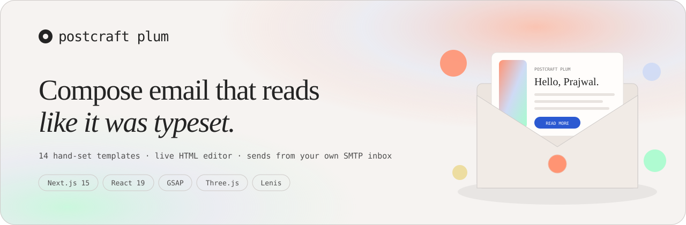
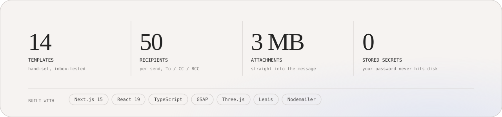
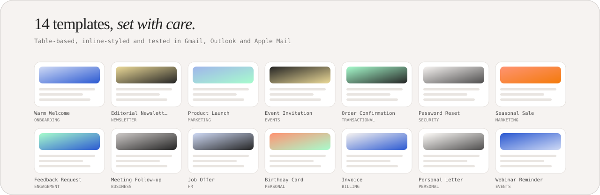

<div align="center">



<br/>

[](https://postcraft-plum.vercel.app)
[](https://nextjs.org)
[](https://react.dev)
[](https://www.typescriptlang.org)
[](https://gsap.com)
[](https://threejs.org)
[](https://lenis.darkroom.engineering)

**[Open the live site →](https://postcraft-plum.vercel.app)** &nbsp;·&nbsp; **[Go straight to the composer →](https://postcraft-plum.vercel.app/compose)**

</div>

---

## Contents

- [What it is](#what-it-is)
- [Why it exists](#why-it-exists)
- [Feature tour](#feature-tour)
- [The template library](#the-template-library)
- [How sending works](#how-sending-works)
- [Provider setup](#provider-setup)
- [Getting started](#getting-started)
- [Environment variables](#environment-variables)
- [Project structure](#project-structure)
- [Motion and 3D](#motion-and-3d)
- [Performance notes](#performance-notes)
- [Accessibility](#accessibility)
- [SEO](#seo)
- [Privacy and security](#privacy-and-security)
- [Deployment](#deployment)
- [Known limits](#known-limits)
- [Credits](#credits)

---

## What it is

**Postcraft Plum** is a browser-based HTML email composer. You pick one of fourteen hand-set
templates — or write raw HTML and CSS — preview it live at desktop, mobile and plain-text widths,
then send it through **your own** mail account over SMTP.

There is no account to create, no subscription, no sending quota of ours, and no tracking pixel in
the message. The mail leaves from your address, so replies come back to you and your existing
deliverability reputation applies.

```
your content ──▶ template renderer ──▶ bulletproof HTML ──▶ your SMTP server ──▶ inbox
                 (tables + inline CSS)                       (one short-lived connection)
```

## Why it exists

Most "email builders" want an account, lock your templates behind their editor, inject tracking,
and send from *their* infrastructure, which means your recipients see `via sendgrid.net` and your
replies land somewhere you do not control.

Postcraft Plum inverts that. It is a rendering tool and a thin SMTP relay. Your credentials pass
through a single serverless function, open one connection, send, and close — nothing is written to
disk. See [Privacy and security](#privacy-and-security) for exactly what happens to them.

---

## Feature tour



### Composing

| | |
|---|---|
| **Fourteen templates** | Table-based layouts with inline styles — the same techniques professional email teams use, so they survive Gmail, Outlook and Apple Mail. Each exposes a small set of typed fields rather than a freeform drag-and-drop canvas. |
| **Raw HTML editor** | Line numbers, tab and shift-tab block indenting, auto-indent on `Enter`, and bracket-aware newlines. Import a `.html` file, paste markup, or convert any template into editable code with one click. |
| **Custom theming** | Accent, button text, background, card, text, muted and border colours; body and heading font stacks; corner radius; plus an **Extra CSS** box injected into the email's `<style>` block. |
| **Live preview** | A sandboxed iframe re-renders on every keystroke. Toggle **Desktop**, **Mobile** (390px, in a device frame) and **Plain text** — the last shows the real `text/plain` alternative that ships alongside the HTML. |
| **Inbox row** | A mock inbox line above the preview shows the sender, subject and the preheader text recipients will actually see in their list view. |

### Sending

| | |
|---|---|
| **Six provider presets** | Gmail, Outlook, Yahoo, Zoho, iCloud and Custom, each with the right host and port prefilled. |
| **Test connection** | Verifies the SMTP handshake and credentials without sending anything. |
| **Send me a test** | Fires the current draft at your own address, skipping CC and BCC. |
| **Recipients** | Up to 50 addresses across To, CC and BCC, with Reply-To support. |
| **Attachments** | Drag-and-drop or click, up to 3 MB total across a maximum of 10 files. |
| **Shortcuts** | `Ctrl`/`Cmd` + `Enter` sends from anywhere in the app. |
| **Autosave** | Draft, theme overrides and a short send history persist in `localStorage`. Credentials are saved **only** if you tick the box. |

### The walkthrough

The landing page embeds a 25-second silent screen recording showing how to create a Gmail app
password — the single thing that blocks a first send. The same clip is one click away inside the
composer, next to the **App password** field. Because it has no audio track and no captions, the
three written steps rendered beside it are the accessible alternative, not an afterthought.

---

## The template library



Every template renders a complete, standalone HTML document. Field values are HTML-escaped, and
link fields run through a URL sanitiser that only permits `http:`, `https:`, `mailto:` and `tel:`.

| # | Template | Category | Description | id |
|--:|---|---|---|---|
| 01 | Warm Welcome | Onboarding | Greet new users with a calm, editorial hello. | `welcome` |
| 02 | Editorial Newsletter | Newsletter | A magazine-style digest with a lead story and briefs. | `newsletter` |
| 03 | Product Launch | Marketing | Announce something new with a bold hero and feature list. | `launch` |
| 04 | Event Invitation | Events | An elegant dark invite with date, venue and RSVP. | `event` |
| 05 | Order Confirmation | Transactional | A clear receipt with line items and totals. | `order` |
| 06 | Password Reset | Security | A focused security email with a code and button. | `reset` |
| 07 | Seasonal Sale | Marketing | A loud-but-tasteful promo with a coupon code. | `sale` |
| 08 | Feedback Request | Engagement | Ask for a rating with one-click score buttons. | `feedback` |
| 09 | Meeting Follow-up | Business | Recap a meeting with action items and next steps. | `followup` |
| 10 | Job Offer | HR | A warm, formal offer letter with key terms. | `offer` |
| 11 | Birthday Card | Personal | A cheerful greeting card with a pastel wash. | `birthday` |
| 12 | Invoice | Billing | A tidy invoice with line items and a pay button. | `invoice` |
| 13 | Personal Letter | Personal | A quiet, serif letter. Just words, beautifully set. | `letter` |
| 14 | Webinar Reminder | Events | A countdown-style reminder with speakers and a join link. | `webinar` |

Open any of them directly: `https://postcraft-plum.vercel.app/compose?template=<id>` — for example
[`?template=invoice`](https://postcraft-plum.vercel.app/compose?template=invoice).

---

## How sending works

```
 Browser                          /api/send (Node runtime)              Your mail provider
────────────                   ─────────────────────────────         ──────────────────────
 compile HTML        POST       validate payload
 + text/plain   ──────────────▶ addresses, sizes, port
 + credentials                          │
                                        ▼
                                 nodemailer.createTransport
                                        │
                                        ├─ action: "verify" ──▶ SMTP handshake only
                                        │
                                        └─ action: "send"   ──▶ AUTH + DATA ──▶ delivered
                                        │
                                 transporter.close()  ← always, in `finally`
                                        │
 toast ◀──────────────────────── accepted / rejected
```

Server-side limits, all enforced in [`app/api/send/route.ts`](app/api/send/route.ts):

| Limit | Value |
|---|---|
| Recipients (To + CC + BCC) | 50 |
| HTML body | 2 MB |
| Attachments | 3 MB total, 10 files |
| Subject | 300 characters, newlines stripped |
| Connection / greeting / socket timeout | 15 s / 10 s / 20 s |
| Function `maxDuration` | 30 s |

SMTP errors are translated into plain language rather than surfaced raw — `EAUTH` becomes a note
about app passwords and 2-Step Verification, `ECONNECTION` becomes a note about the host and port,
and so on.

---

## Provider setup

Nearly every provider now requires an **app password** rather than your account password.

| Provider | Host | Port | Where to get an app password |
|---|---|--:|---|
| Gmail | `smtp.gmail.com` | 465 | Turn on 2-Step Verification, then [myaccount.google.com/apppasswords](https://myaccount.google.com/apppasswords) |
| Outlook | `smtp-mail.outlook.com` | 587 | [account.live.com/proofs/AppPassword](https://account.live.com/proofs/AppPassword) — some tenants disable SMTP AUTH |
| Yahoo | `smtp.mail.yahoo.com` | 465 | Account Security → Generate app password |
| Zoho | `smtp.zoho.com` | 465 | Security → App passwords (use `.eu` / `.in` for those regions) |
| iCloud | `smtp.mail.me.com` | 587 | Apple Account → App-Specific Passwords |
| Anything else | your host | your port | Custom preset — Amazon SES, Postmark, Mailgun, your own server |

Ports 465 (implicit TLS) and 587 (STARTTLS) are both handled; `secure` is inferred from the port
unless you override it.

---

## Getting started

**Requirements:** Node 18.18 or newer (20 LTS recommended) and npm.

```bash
git clone https://github.com/prajwal032004/postcraft.git
cd postcraft
npm install
npm run dev
```

Open <http://localhost:3000>.

| Script | What it does |
|---|---|
| `npm run dev` | Dev server with hot reload |
| `npm run build` | Production build |
| `npm start` | Serve the production build |
| `npm run lint` | Next's ESLint pass |

> **If the dev server throws `Cannot find module .next/server/middleware-manifest.json`,** a build
> was interrupted and left `.next` half-written. Stop the server, `rm -rf .next`, and start again.

## Environment variables

None are required. One is optional:

| Variable | Default | Purpose |
|---|---|---|
| `NEXT_PUBLIC_SITE_URL` | `https://postcraft-plum.vercel.app` | Canonical origin for metadata, JSON-LD, `sitemap.xml` and `robots.txt`. Set it if you deploy elsewhere. |

There is deliberately **no** `SMTP_USER` or `SMTP_PASS`. Credentials belong to the person sending,
are supplied per request, and are never read from the server environment.

---

## Project structure

```
app/
  layout.tsx              root metadata, fonts, verification tags
  page.tsx                landing + WebSite/Person/WebApplication/VideoObject/FAQPage JSON-LD
  not-found.tsx           404
  globals.css             design tokens and every landing style
  compose/
    page.tsx              composer metadata + BreadcrumbList JSON-LD
    composer.css          composer-only styles
  api/send/route.ts       the SMTP relay — the only server-side logic
  opengraph-image.tsx     1200x630 social card
  video-thumbnail/        1280x720 poster, also the VideoObject thumbnailUrl
  robots.ts  sitemap.ts  manifest.ts

components/
  TemplateThumb.tsx       lazy, scaled iframe miniature of a template
  VideoShowcase.tsx       the silent-clip player
  landing/
    Landing.tsx           section orchestration and all scroll choreography
    Nav.tsx               sticky nav, progress bar, mobile drawer
    Preloader.tsx         one-per-session curtain
    Cursor.tsx            custom pointer (fine pointers only)
    HeroScene.tsx         Three.js envelope, dust and floaters
    CtaScene.tsx          Three.js aurora shader behind the closing panel
    TemplateCard.tsx      gallery card
  composer/
    Composer.tsx          the whole editor
    CodeEditor.tsx        textarea with gutter and indent handling

lib/
  templates.ts            the 14 templates, theming, HTML-to-text
  site.ts                 single source of truth for name, origin, search copy
  faq.ts                  FAQ copy, shared by the accordion and the FAQPage schema
  video.ts                clip facts, shared by the player and the schema
  gsap.ts                 plugin registration and signature easings
  smoothScroll.ts         Lenis instance, scroll lock, anchor handling
```

A few of these splits are deliberate rather than cosmetic:

- **`lib/faq.ts`** exists so the rendered accordion and the `FAQPage` structured data are generated
  from one array. Structured data that contradicts the visible page is the usual reason rich
  results get rejected.
- **`lib/video.ts`** exists because `VideoShowcase` is a `"use client"` module, and a server
  component that imports a plain constant from a client module receives `undefined`. That silently
  emitted `PTundefinedS` as the video duration until it was caught in the built HTML.
- **`lib/site.ts`** keeps the brand name and the deployed origin from drifting apart across
  metadata, JSON-LD, the sitemap, robots, the manifest and two generated images.

---

## Motion and 3D

**GSAP** drives everything timed. Plugins are registered once in `lib/gsap.ts`, along with three
`CustomEase` curves (`craft`, `craftIn`, `craftInOut`) so easing is consistent across the site.

- `ScrollTrigger` pins the hero and scrubs a scroll progress value into the 3D scene; it also pins
  the template gallery and converts vertical scroll into horizontal travel.
- `SplitText` masks the hero headline **by word, not by line** — word masks keep natural wrapping,
  so resizing the window never leaves the headline broken.
- `DrawSVGPlugin` draws the pipeline connector curves, whose paths are measured from the live DOM.
- `gsap.matchMedia` gates the pins: below 721px the hero stops pinning, and below 861px the gallery
  falls back to native snap-scroll.

**Three.js** appears twice, both times lazily via `next/dynamic` with `ssr: false`:

- **`HeroScene`** — a paper envelope that unseals, lifts its letter and drifts apart across three
  scroll beats, with a dust field, a contact shadow, a canvas-drawn letter texture and a stamp.
- **`CtaScene`** — a custom fragment shader (fBm noise over the brand palette) plus an instanced
  mesh of tumbling paper rectangles behind the dark closing panel.

Both scenes cap device pixel ratio, reduce geometry detail on coarse pointers, pause on
`visibilitychange`, and stop rendering entirely when scrolled out of view.

**Lenis** provides smooth scrolling, driven by GSAP's ticker and feeding `ScrollTrigger.update()` on
every scroll event — the pairing GSAP recommends for pinned sections. It is deliberately **not**
used on `/compose`, which is a fixed-height app shell with its own scroll panes.

Every one of these respects `prefers-reduced-motion`.

---

## Performance notes

- **Three.js is not in the initial bundle.** Both scenes are dynamically imported, so the landing
  page ships ~186 kB of First Load JS.
- **Template miniatures mount lazily.** Fourteen live iframes is a lot of layout work, so
  `TemplateThumb` uses an `IntersectionObserver` and renders a palette gradient until a card nears
  the viewport.
- **The 2.3 MB video never touches first paint.** `preload="none"`, and the `<source>` element is
  only attached once the section is within 500px. Verified: zero `<source>` tags in the server HTML.
- **Fonts** are self-hosted by `next/font` with `display: swap` and no layout-shift penalty.

## Accessibility

- A skip link, visible focus rings on every control, and semantic landmarks.
- The FAQ uses real `<button>` elements with `aria-expanded` / `aria-controls` over `role="region"`.
- The mobile drawer is a labelled `role="dialog"` that traps scroll, closes on `Escape`, and pulls
  its links out of the tab order while shut.
- The custom cursor only activates for `(pointer: fine)` and never replaces the native caret.
- Decorative canvases, duplicated marquee items and the preloader are `aria-hidden`.
- The silent tutorial clip is paired with written steps as its text alternative.
- A `<noscript>` block reveals any content the intro animation would otherwise leave hidden.

## SEO

- Per-page canonicals, titles sized to **56 and 43 characters**, descriptions to **153 and 155** —
  all inside what Google renders before truncating.
- JSON-LD: `WebSite`, `Person`, `WebApplication`, `VideoObject` and `FAQPage` on the landing page;
  `BreadcrumbList` on the composer.
- `robots.txt`, `sitemap.xml` and a web manifest, all generated from `lib/site.ts`.
- Generated Open Graph card and a separate video poster.
- Google Search Console and Bing Webmaster verification tags.

> The `<meta name="keywords">` tag is present but kept short and honest. Google has ignored it since
> 2009 and Bing weights it near zero; the ranking work is in the title, description, headings and
> page copy.

---

## Privacy and security

**What reaches the server.** Your SMTP host, port, address and app password are posted to
`/api/send` over HTTPS, used to open a single connection, and discarded when the request ends. They
are never logged, never written to disk, and never placed in an environment variable. The
`finally` block closes the transport on every path, including failures.

**What stays in your browser.** Under `localStorage`:

| Key | Contents |
|---|---|
| `postcraft:draft:v1` | Current draft, field values and theme overrides |
| `postcraft:creds:v1` | Credentials — **written only when you tick "Remember on this device"**, deleted the moment you untick it |
| `postcraft:history:v1` | Last 8 sends: subject, recipients, timestamp |
| `postcraft:seen-intro` | Session flag so the intro curtain plays once |

**Input handling.** Template fields are HTML-escaped; URL fields are restricted to
`http:`/`https:`/`mailto:`/`tel:`; recipient addresses are validated before any connection opens;
the sender display name is stripped of quotes and CRLF, and the subject of newlines, to prevent
header injection. The preview iframe is sandboxed.

**What is not here.** No analytics, no tracking pixels, no link rewriting, no third-party scripts
beyond the shields.io badges in this file.

---

## Deployment

Built for Vercel, but it is a standard Next.js app — anything with a Node runtime works.

1. Import the repository.
2. Optionally set `NEXT_PUBLIC_SITE_URL` to your own domain.
3. Deploy.

`vercel.json` raises the `/api/send` function to a 30-second `maxDuration`, since slow SMTP
handshakes can outlast the default.

## Known limits

- **Hero copy starts at `opacity: 0`** and is revealed by the intro timeline. Search engines render
  JavaScript so it indexes fine, but it does cost some LCP.
- **No email client testing matrix.** Templates follow table-and-inline-style conventions and have
  been checked in major clients, but there is no Litmus or Email on Acid integration.
- **Rate limiting is per-provider.** The app imposes no quota of its own, so your provider's daily
  send limit is the real ceiling — roughly 500/day for consumer Gmail.
- **Line endings.** The repo has no `.gitattributes`; if you work across Windows and Linux, add one
  with `* text=auto eol=lf`.

---

## Credits

Built by **Prajwal A Bhandagi**.

Type is [Instrument Serif](https://fonts.google.com/specimen/Instrument+Serif) and
[JetBrains Mono](https://fonts.google.com/specimen/JetBrains+Mono). Motion by
[GSAP](https://gsap.com), 3D by [Three.js](https://threejs.org), smooth scrolling by
[Lenis](https://lenis.darkroom.engineering), delivery by [Nodemailer](https://nodemailer.com).

No licence file is included yet — add one if you want others to reuse this.

<div align="center">
<br/>

**[postcraft-plum.vercel.app](https://postcraft-plum.vercel.app)**

</div>
